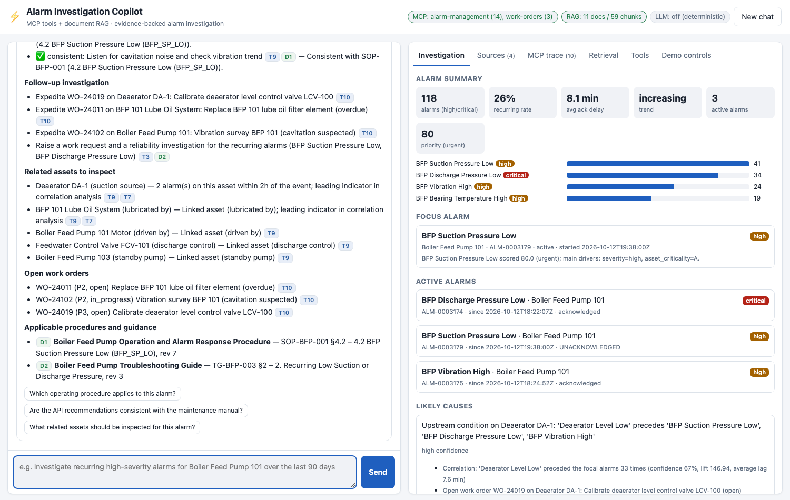
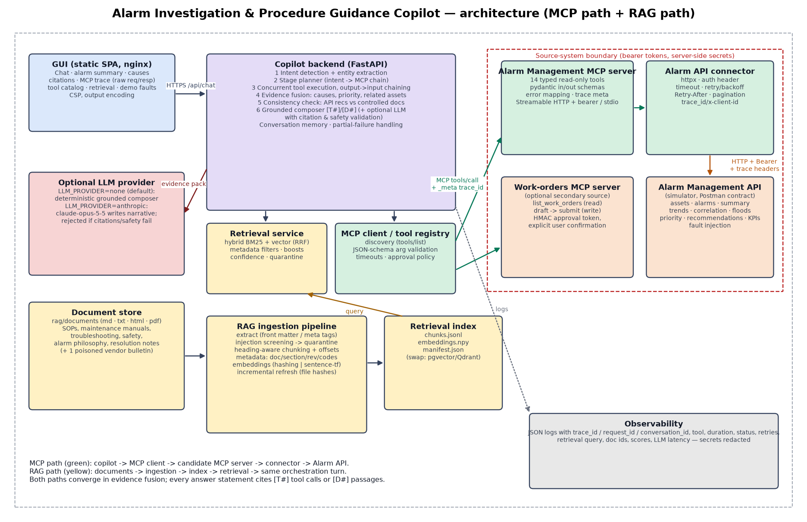

# Alarm Investigation and Procedure Guidance Copilot

Evidence-backed alarm investigation for operators and reliability engineers. The copilot does three things in one
workflow. It calls the **Alarm Management API through a candidate-developed MCP server**. It retrieves
**controlled procedures, manuals and safety instructions through document RAG**. It fuses both into a
**grounded answer** in which every statement cites either an MCP tool call `[T#]` or a document passage `[D#]`.
The GUI shows the full MCP execution trace with raw requests and responses.



> **Demo video (≤ 10 min):** _<add link after upload>_ - recording script: [docs/demo-script.md](docs/demo-script.md)
> · Screenshots: [docs/screenshots/](docs/screenshots/)

---

## Contents
1. [Selected use case & capabilities](#1-selected-use-case--capabilities)
2. [Technology stack](#2-technology-stack)
3. [Architecture summary](#3-architecture-summary)
4. [MCP servers & tool list](#4-mcp-servers--tool-list)
5. [RAG corpus & ingestion](#5-rag-corpus--ingestion)
6. [Quick start](#6-quick-start)
7. [Configuration](#7-configuration)
8. [Build, run and test commands](#8-build-run-and-test-commands)
9. [Sample interactions](#9-sample-interactions)
10. [Repository structure](#10-repository-structure)
11. [Assumptions](#11-assumptions)
12. [Known limitations & future work](#12-known-limitations--future-work)

---

## 1. Selected use case & capabilities

**Use case:** *Alarm Investigation and Procedure Guidance Copilot.*

| Capability | How |
|---|---|
| Natural-language requests, intent detection | 8 intents (investigate, active response, priority ranking, related assets, procedure lookup, consistency check, alarm performance, document question) with explainable cues and entity extraction |
| MCP tool discovery & schema-aware invocation | `tools/list` on every server per turn; arguments validated against the discovered JSON Schema before the call |
| Multi-step chaining | e.g. `search_assets → get_asset_metadata → summarize_alarms / get_alarm_trends / get_alarms (paginated) → correlate_alarms (incl. related assets) → score_alarm_priority → recommend_operator_actions → list_work_orders`. Each step's output parameterises the next; independent steps run concurrently |
| Document RAG in the same workflow | Retrieval queries and filters are derived from MCP outputs (focal alarm, alarm code, equipment classes, site, leading indicators, each API recommendation) |
| Combined reasoning | Likely causes = correlation leading indicators + documented failure modes + open work orders, each with a confidence level. API recommendations are checked against controlled documents: ✅ consistent / ⚠️ conflict / ➖ not covered |
| Grounded answers | Deterministic grounded composer (default, offline). Optional Claude (`claude-opus-5-5`) rewrite, accepted only if its citations and safety wording validate |
| Failure handling | Retries/backoff, typed error codes, invalid args, unavailable tools/servers, partial failures → `partial` answer with evidence gaps, low-confidence retrieval, clarification questions |
| Security | Bearer boundaries (API, both MCP servers), secret redaction, prompt-injection quarantine and sanitisation, CSP + output encoding, write operations only with explicit, server-verified approval |
| GUI | Chat, alarm summary, causes and recommendations, citations, expandable MCP trace (raw request/response + underlying API calls), tool catalog, retrieval diagnostics, demo fault injection, loading/error/empty states, responsive layout |

## 2. Technology stack

Python 3.12 · MCP Python SDK 2.3 (`MCPServer`, Streamable HTTP, `Client`) · FastAPI/Uvicorn · httpx · Pydantic 2 /
pydantic-settings · NumPy (vector index) · BM25 (own implementation) · pypdf · jsonschema · Anthropic SDK
(optional) · static ES-module SPA (no build) + nginx · pytest, respx, Playwright · ruff, mypy · Docker Compose ·
GitHub Actions.

## 3. Architecture summary



* **GUI → Copilot backend** (`apps/backend/copilot`): orchestration, intent, MCP client/tool registry,
  evidence fusion, grounded composer, conversation memory.
* **MCP path:** MCP client → **Alarm Management MCP server** (`mcp-servers/alarm-management`, 14 tools) →
  **connector** (`connectors/alarm_connector`: auth, retry, timeout, error mapping, pagination, trace headers) →
  **Alarm Management API simulator** (`apps/simulator`, implemented from the Postman collections).
  An optional **work-orders MCP server** (`mcp-servers/work-orders`) adds a second source and an approved write.
* **RAG path:** documents (`rag/documents`) → ingestion (`rag/ingestion`) → index (`var/rag-index`) →
  hybrid retriever (`rag/retrieval`) → same orchestration turn.
* **Observability:** JSON logs carrying `trace_id`/`request_id`/`conversation_id`. One trace id flows from the
  GUI request through MCP `_meta` to the Alarm API `trace_id` header.

Details: [docs/architecture.md](docs/architecture.md) · decisions: [docs/design-decisions.md](docs/design-decisions.md)
· API integration: [docs/api-integration.md](docs/api-integration.md).

## 4. MCP servers & tool list

### Alarm Management MCP server (candidate-developed)

| Tool | Purpose | API operation |
|---|---|---|
| `search_assets` | resolve names/tags to asset ids (best match, ambiguity flag) | `GET /assets/search` |
| `get_asset_metadata` | criticality, limits, related assets, procedure refs | `GET /assets/{id}/metadata` |
| `get_alarms` | filtered alarm retrieval, pagination / fetch-all | `GET /alarms` |
| `get_alarm_details` | one alarm | `GET /alarms/{id}` |
| `summarize_alarms` | grouped counts + KPIs (recurring rate, ack delay …) | `POST /alarms/summary` |
| `get_alarm_trends` | bucketed trend + direction | `POST /alarms/trends` |
| `correlate_alarms` | co-occurrence pairs, leading indicators (incl. related assets) | `POST /alarms/correlation` |
| `analyze_alarm_floods` | flood windows | `POST /alarms/flood-analysis` |
| `find_rationalization_candidates` | chattering / stale / frequent alarms | `POST /alarms/rationalization-candidates` |
| `score_alarm_priority` | 0-100 score + factors | `POST /alarms/priority-score` |
| `rank_alarm_priorities` | concurrent scoring + ranking with partial results | `POST /alarms/priority-score` × N |
| `recommend_operator_actions` | rule-engine actions, related assets, history | `POST /recommendations/operator-actions` |
| `calculate_kpi` | generate + execute KPI calculation | `POST /calculation-code/generate` → `/execute` |
| `list_kpi_definitions` | KPI catalog | `GET /analytics/kpi-definitions` |

### Work-orders MCP server (secondary)
`list_work_orders` (read), `draft_work_request` (no write; returns an HMAC approval token), `submit_work_request`
(**write**; requires the token plus explicit user confirmation in the GUI).

Full catalog with input/output schemas, auth, error and timeout behaviour, and real example invocations and
responses: **[docs/mcp-tool-catalog.md](docs/mcp-tool-catalog.md)** (generated by `scripts/generate_tool_catalog.py`).

### Running the MCP server independently

```bash
# Streamable HTTP (needs the Alarm API at ALARM_API_BASE_URL)
PYTHONPATH=libs:connectors:mcp-servers/alarm-management \
ALARM_API_BASE_URL=http://127.0.0.1:8000 ALARM_API_TOKEN=... MCP_AUTH_TOKEN=... \
python -m alarm_mcp                       # -> http://127.0.0.1:9000/mcp  (health: /health)

# stdio (MCP Inspector / Claude Desktop / any MCP host)
MCP_TRANSPORT=stdio python -m alarm_mcp
npx @modelcontextprotocol/inspector python -m alarm_mcp   # optional, to browse the tools

# Docker
docker compose up alarm-api alarm-mcp
```

## 5. RAG corpus & ingestion

11 synthetic documents in Markdown, HTML and text (PDF is also supported): BFP operating procedure, BFP maintenance
manual, BFP troubleshooting guide, compressor SOP and troubleshooting guide, electrical safety and motor trip
response, motor maintenance manual, alarm management philosophy (HTML), general process safety, an incident
resolution note (text), and an **uncontrolled vendor bulletin with an embedded prompt-injection payload** that
exercises the defences.

Pipeline: extraction (front matter / HTML meta) → injection screening → heading-aware chunking with contextual
headers → rich metadata (doc type, equipment classes, alarm codes incl. chunk-level, site, revision, section,
offsets, trust level) → embeddings (offline hashing by default, sentence-transformers optional) → atomic file
index → hybrid BM25 + vector retrieval with RRF, filters and boosts → confidence → citations.

```bash
python -m rag.ingestion.cli --docs rag/documents --index var/rag-index   # incremental; add --rebuild to force
```

Design and examples: **[docs/rag-design.md](docs/rag-design.md)**.

## 6. Quick start

### Option A - Docker (recommended)
```bash
cp .env.example .env          # replace every "replace-me"
docker compose up --build
# GUI  http://localhost:3000   · API docs http://localhost:8080/docs · Alarm API http://localhost:8000/docs
```
Start order with health checks: `alarm-api` → `alarm-mcp`, `work-orders-mcp` → `rag-ingest` (one-shot) →
`copilot-backend` → `frontend`.

### Option B - local, no Docker
```bash
python3.12 -m venv .venv && .venv/bin/pip install -r requirements-dev.txt
scripts/run_local.sh          # starts simulator, both MCP servers, backend; GUI at http://127.0.0.1:8080
```

## 7. Configuration

All configuration comes from environment variables. See **[.env.example](.env.example)**.

| Variable | Default | Used by |
|---|---|---|
| `ALARM_API_BASE_URL`, `ALARM_API_TOKEN` | `http://alarm-api:8000`, - | MCP server connector (and demo controls) |
| `ALARM_API_TIMEOUT_SECONDS`, `ALARM_API_MAX_RETRIES`, `ALARM_API_TOTAL_TIMEOUT_SECONDS` | 10, 3, 30 | connector |
| `SIM_API_TOKENS`, `SIM_SEED`, `SIM_DATA_END`, `SIM_FAULT_RATE`, `SIM_LATENCY_MS` | | simulator |
| `MCP_SERVER_URL`, `MCP_AUTH_TOKEN`, `MCP_TRANSPORT`, `MCP_HOST`, `MCP_PORT` | `:9000/mcp` | backend / MCP server |
| `WORK_ORDERS_MCP_URL`, `WORK_ORDERS_MCP_TOKEN`, `WO_MCP_SIGNING_KEY` | | backend / work-orders server |
| `MCP_TOOL_TIMEOUT_SECONDS` | 45 | MCP client |
| `DOCUMENT_PATH`, `RAG_INDEX_PATH`, `EMBEDDING_PROVIDER`, `RAG_AUTO_INGEST` | `rag/documents`, `var/rag-index`, `hashing`, true | RAG |
| `LLM_PROVIDER`, `LLM_MODEL`, `LLM_API_KEY`, `LLM_EFFORT` | `none`, `claude-opus-5-5` | optional LLM |
| `COPILOT_DEFAULT_LOOKBACK_DAYS`, `COPILOT_REFERENCE_TIME` | 90, now | orchestration |
| `ENABLE_DEMO_CONTROLS` | false | fault-injection panel (test harness only) |

No secrets are committed. All tokens are `SecretStr` and are redacted from logs and tool results.

## 8. Build, run and test commands

| Task | Command |
|---|---|
| Install dev env | `make install` |
| Lint / format | `make lint` (ruff) · `make format` |
| Static analysis | `make typecheck` (mypy, 50 files, clean) |
| All tests | `make test` → **152 passed** |
| Coverage | `make coverage` → **93 %** (gate 80 %) - see [docs/test-report.md](docs/test-report.md) |
| Unit / MCP / RAG / E2E | `make test-unit` · `make test-mcp` · `make test-rag` · `make test-e2e` |
| Build index | `make ingest` |
| Run MCP server alone | `make mcp` |
| Whole stack (local / Docker) | `make run` · `make up` |
| Screenshots | `make screenshots` (Playwright) |
| Dependency audit | `make audit` |

The test suite includes a **replay of all three Postman collections** against the simulator, MCP server and client
tests through real MCP sessions, RAG relevance and injection tests, orchestration tests, the **mandatory acceptance
scenario over real HTTP** (all services on ephemeral ports, bearer auth, Streamable HTTP), and a **headless-browser
GUI test**.

## 9. Sample interactions

| Question | What happens |
|---|---|
| *Investigate recurring high-severity alarms for Boiler Feed Pump 101 over the last 90 days, identify likely contributing factors, retrieve the relevant operating procedure, and provide recommended actions with source evidence.* | 10 MCP calls. ~115-120 high/critical alarms (the window is relative to now), increasing trend. Causes: **Deaerator DA-1 level low precedes BFP suction pressure low** (high confidence: correlation + open WO-24019 LCV-100 + TG-BFP-003 §2); lube oil pressure → bearing temperature (WO-24011 overdue filter). Immediate actions from **SOP-BFP-001 §4.2**; API recommendations consistent. |
| *Show active critical alarms for Boiler Feed Pump 102 and recommend immediate actions.* | Active `BFP Discharge Pressure Low` (critical, unacknowledged, score 85.5) → SOP-BFP-001 §4.1 steps + consistent API recommendations, related assets, open WO. |
| *Why are compressor discharge pressure alarms repeatedly occurring?* | Generic class → K-201/K-202/K-203. Intercooler E-201 outlet temperature and anti-surge valve FV-202 deviation are leading indicators (with WOs), backed by TG-CMP-011 §1. SOP-CMP-010 §3.1 actions; deadband review. |
| *Which alarm has the highest priority in EastRefinery, and why?* | Ranks 7 active alarms → **Motor Trip on M-501 (91, urgent)**. Cites ALM-PHIL-030 §2. **Conflict:** the rule engine says "reset relay and restart"; SAF-ELE-020 §2 forbids it → follow the controlled procedure. |
| *What related assets should be inspected for this motor trip alarm?* (follow-up) | Uses the conversation context (M-501): P-501 and MCC-5 with correlation evidence, SAF-ELE-020 §3. |
| *Are the API recommendations consistent with the maintenance manual?* / *Which operating procedure applies to this alarm?* | Context-aware consistency table / procedure citation. |
| Fault injection: correlation endpoint down | `partial` status, red trace entry `UPSTREAM_UNAVAILABLE` after 4 attempts, evidence-gaps section, still grounded. |
| *Investigate alarms on Flux Capacitor Pump 999* | `needs_clarification` - asset not found, asks for the DCS name or tag. |

## 10. Repository structure

```
.
├── README.md  LICENSE  Dockerfile  docker-compose.yml  Makefile  pyproject.toml
├── requirements.txt  requirements-dev.txt  .env.example  .gitignore
├── .github/workflows/ci.yml  .github/pull_request_template.md
├── docs/            architecture.md · architecture-diagram.png · mcp-tool-catalog.md · rag-design.md
│                    api-integration.md · design-decisions.md · known-limitations.md · test-report.md
│                    demo-script.md · screenshots/
├── apps/
│   ├── backend/copilot/        orchestrator, intent, MCP client, evidence, composer, LLM, API
│   ├── frontend/               static SPA + nginx Dockerfile
│   └── simulator/alarm_simulator/   Alarm Management API simulator (Postman contract)
├── mcp-servers/
│   ├── alarm-management/alarm_mcp/  candidate MCP server (14 tools)
│   └── work-orders/work_orders_mcp/ optional secondary server (approval-gated write)
├── connectors/alarm_connector/      reusable API connector
├── libs/platform_common/            logging/redaction, tracing, ASGI bearer auth
├── rag/  ingestion/ · retrieval/ · documents/ · tests/
├── tests/ unit/ · integration/ · e2e/
├── test-data/postman/               assignment collections (contract tests)
└── scripts/ run_local.sh · capture_screenshots.py · generate_tool_catalog.py · render_architecture_diagram.py
```
(Python packages live in hyphen-free sub-directories so they are importable. `PYTHONPATH` is set in the
Dockerfile, Makefile and `pyproject.toml`.)

## 11. Assumptions

* The Postman collections define the API. Response shapes not shown in Postman (it has no saved responses) were
  designed to satisfy the collection scripts (`results[].asset_id`, `data[].alarm_id`, `calculation_id`,
  `flood_windows[].start/end`) and the copilot's needs.
* "Last 90 days" is relative to now. The simulator generates history up to its start time, so relative windows
  always contain data. Tests pin the time to 2026-10-12.
* Units are unique names across sites (Unit 1-2 NorthPlant, 3-4 SouthPlant, 5-6 EastRefinery).
* All documents are synthetic and owned by the plant. `trust_level` comes from document metadata.
* The default deployment needs no external services or API keys (no LLM, offline embeddings).

## 12. Known limitations & future work

See **[docs/known-limitations.md](docs/known-limitations.md)**. In short: synthetic data, rule-based intent
detection, lexical-semantic default embeddings, heuristic consistency checks, single-replica in-memory state,
static bearer tokens. Next steps: OAuth for MCP, an optional LLM planner, neural embeddings with re-ranking,
pgvector/Redis, OpenTelemetry, streaming responses.
