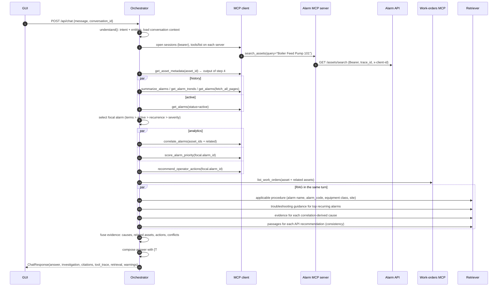

# Architecture

(Regenerate with `python scripts/render_architecture_diagram.py`.)

## 1. Components and boundaries

| Layer | Component | Location | Responsibility |
|---|---|---|---|
| User interface | Static SPA (nginx in Docker, or served by the backend locally) | `apps/frontend/` | Chat, alarm summary, causes/recommendations, citations, expandable MCP trace with raw request/response, tool catalog, retrieval diagnostics, demo fault controls, work-request confirmation dialog. No build step; CSP `script-src 'self'`; all model/document text is HTML-escaped before rendering. |
| Copilot orchestration | `copilot.orchestrator.Orchestrator` | `apps/backend/copilot/` | Intent → stage plan → MCP chain + RAG → evidence fusion → grounded answer. |
| Intent / planning | `copilot.intent` | ″ | Weighted, explainable cue classifier (8 intents) + entity extraction (asset phrases, tags, ids, site, unit, severity, status, window, alarm terms, context references). |
| MCP client / tool registry | `copilot.mcp_client` | ″ | Per-request sessions to every configured MCP server, paginated discovery, client-side JSON-Schema validation, approval policy for write tools, timeouts, transport retry, uniform `ToolCallRecord`s. |
| Candidate MCP server | `alarm_mcp` | `mcp-servers/alarm-management/` | 14 typed read-only tools over the Alarm Management API (MCP Python SDK 2.x `MCPServer`), Streamable HTTP + bearer auth or stdio. |
| Secondary MCP server | `work_orders_mcp` | `mcp-servers/work-orders/` | CMMS mock: open work orders (read) and a draft → approve → submit write flow. |
| API connector | `alarm_connector.AlarmApiClient` | `connectors/` | Auth header, timeouts, retry/backoff, Retry-After, trace headers, error mapping, pagination; returns `CallRecord`s. |
| Source system | Alarm Management API simulator | `apps/simulator/` | FastAPI implementation of the Postman contract with deterministic synthetic data, embedded causal patterns, bearer auth, trace echo, request log, fault injection. |
| RAG ingestion | `rag.ingestion` | `rag/ingestion/` | Discover → extract → screen for injection → heading-aware chunking → metadata → embeddings → atomic index write (incremental). |
| Retrieval service | `rag.retrieval` + `copilot.rag_service` | `rag/retrieval/`, backend | Hybrid BM25 + vector with RRF, metadata filters/boosts, diversity, confidence, quarantine, sanitisation, citations. |
| Domain models | Pydantic models | `alarm_mcp/schemas.py`, `copilot/models.py`, `alarm_simulator/models.py` | Typed contracts at every boundary. |
| Authentication & configuration | `pydantic-settings` classes, `platform_common.asgi_auth` | each service | Env-driven config (`.env.example`), `SecretStr` for secrets, bearer boundaries on API and both MCP endpoints. |
| Observability | `platform_common.logging/tracing` | `libs/` | JSON logs with trace/request/conversation ids, redaction of secrets; per-call records surfaced in the GUI. |
| Persistence | File index (`var/rag-index`), in-memory conversation store (LRU+TTL) | | Swappable (pgvector/Qdrant, Redis) behind small interfaces. |

**Rule enforced by design:** the copilot has *no* Alarm API client. The only path to alarm data is the MCP client →
MCP server. (The demo fault-injection proxy is a test-harness endpoint, disabled by default, and never used for
business data.)

## 2. Request flow (prompt → grounded answer)

Steps in prose:

1. **Understand** – `intent.understand()` returns intent, confidence, matched cues (shown in the GUI) and entities.
   Context references ("this alarm") resolve to the conversation's focal alarm/asset.
2. **Discover** – an MCP session is opened to each server; `tools/list` is paginated; tools are registered with
   their schemas and read-only flag. A server that cannot be reached is marked unavailable (degraded mode).
3. **Resolve scope** – asset ids, asset phrases (`search_assets`; generic equipment classes such as "compressor"
   expand to all matching assets of that type), alarm ids, or site/unit; otherwise ask for clarification.
4. **Gather alarm evidence** – metadata (related assets), summary/KPIs, trend, alarm history (paginated) and active
   alarms run **concurrently**.
5. **Focal alarm** – the alarm to centre on is selected from the tool outputs.
6. **Analytics** – correlation over the asset *and its related assets*, priority score or ranking, operator
   recommendations, open work orders – all parameterised with outputs of earlier steps.
7. **RAG** – retrieval queries and filters are *built from MCP outputs* (focal alarm name/code, equipment classes
   of the asset and its related assets, site, recurring alarm names, leading indicators, each API recommendation).
8. **Fusion** – likely causes = correlation leading indicators + documented failure modes + open work orders,
   with explicit confidence; API recommendations are checked against controlled documents
   (supported / conflict / not covered); procedure steps are extracted from the cited section.
9. **Compose** – deterministic grounded Markdown with `[T#]` (tool call) and `[D#]` (passage) refs; optional LLM
   rewrite is accepted only if every cited id exists and no unsafe wording is present.
10. **Respond & remember** – structured response for the GUI; conversation memory updated.

## 3. Failure handling

| Failure | Where handled | Result |
|---|---|---|
| Transient API error (429/502/503/504, timeout, connection) | connector retries with backoff / Retry-After | Success with `attempts`/`retries` visible in the trace |
| Persistent API failure | connector → typed error → MCP `isError` JSON | Step warning, response `partial`, answer still grounded on remaining evidence |
| Invalid tool arguments | client-side JSON-Schema validation; server-side Pydantic + cross-field checks | `invalid_arguments` record, no API call |
| Unknown / unavailable tool | registry lookup | `unavailable` record, stage skipped |
| MCP server unreachable | session open | document-only answer, `partial` |
| Retrieval index missing | `RagService` auto-ingest or warning | answer without documents, `partial` |
| Low-confidence / no retrieval | confidence scoring | explicit "no controlled procedure found" note instead of guessing |
| Injected instructions in documents | ingestion screening, quarantine, sanitisation, untrusted-data framing | passage excluded and reported |
| LLM failure / ungrounded output | `llm_answer` validation | deterministic answer + warning |

## 4. Security boundaries

* GUI → backend: same-origin (nginx proxy), CSP, no inline script, output encoding, request validation
  (length, id patterns).
* Backend → MCP servers: bearer token per server (`MCP_AUTH_TOKEN`, `WORK_ORDERS_MCP_TOKEN`).
* MCP server → Alarm API: bearer token held only by the MCP server.
* Write operations: tool annotations mark them non-read-only; the client denies them without `approved=True`,
  which is only set by the explicit confirmation endpoint; the server additionally verifies an HMAC-signed,
  single-use, expiring approval token.
* Secrets are `SecretStr`, never returned, and masked by the log redaction filter (keys and token-like values).

## 5. Deployment

`docker compose up --build` starts `alarm-api` → `alarm-mcp` (healthy) and `work-orders-mcp` (healthy) →
`rag-ingest` (one-shot, completes) → `copilot-backend` (healthy) → `frontend` (nginx on :3000). All services expose
health checks; the Python services share one non-root image.
